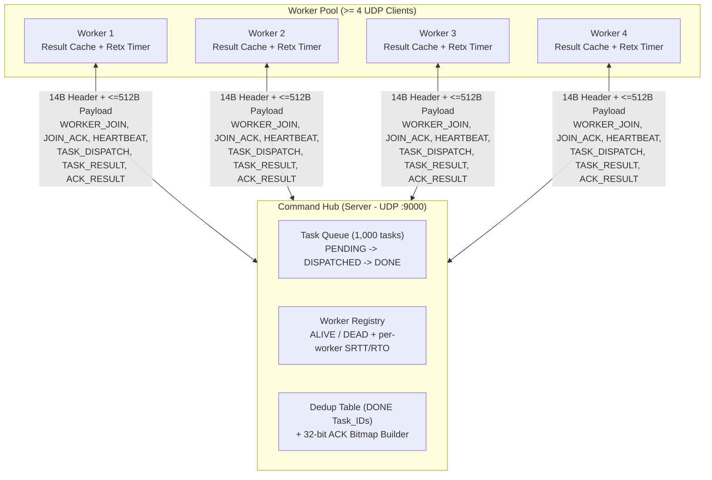
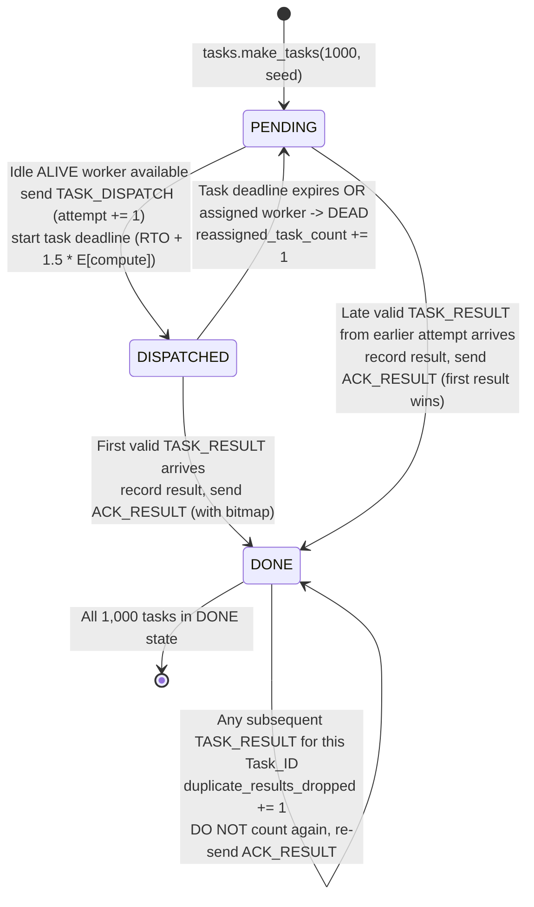
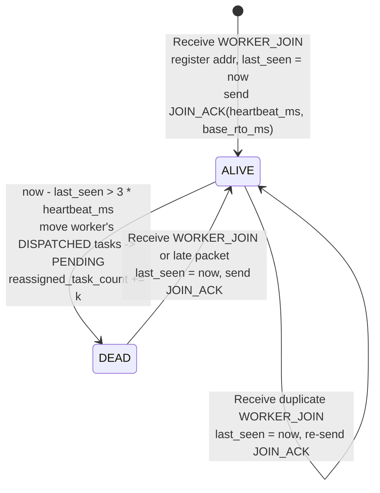
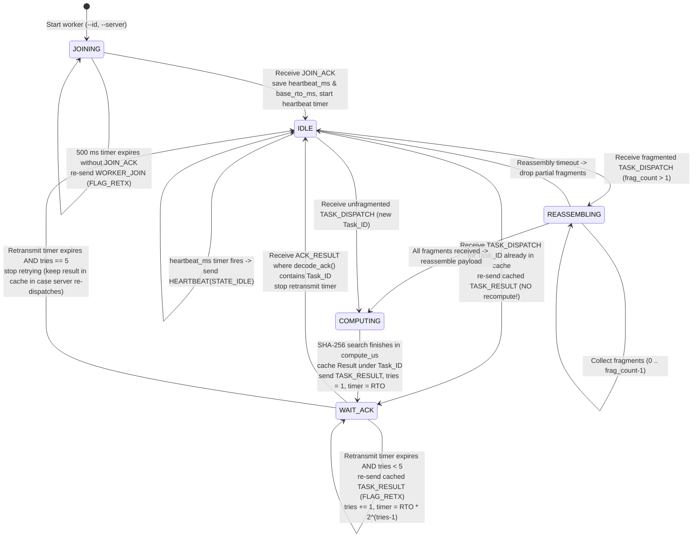

# RJDAP Architecture & State Machine Diagrams

This folder contains the architecture and Finite State Machine (FSM) diagrams for **RJDAP v1**, maintained by **R1 (Protocol Architect & RFC Lead)**. These diagrams match [`src/protocol.py`](../../src/protocol.py) and [`docs/rfc/MINI_RFC.md`](../rfc/MINI_RFC.md) byte-for-byte.

---

## 1. System Topology & Message Flow

---

## 2. Command Hub: Per-Task State Machine

Each of the 1,000 tasks in the Command Hub transitions independently through three states:

---

## 3. Command Hub: Worker Liveness State Machine

---

## 4. Worker Node State Machine

