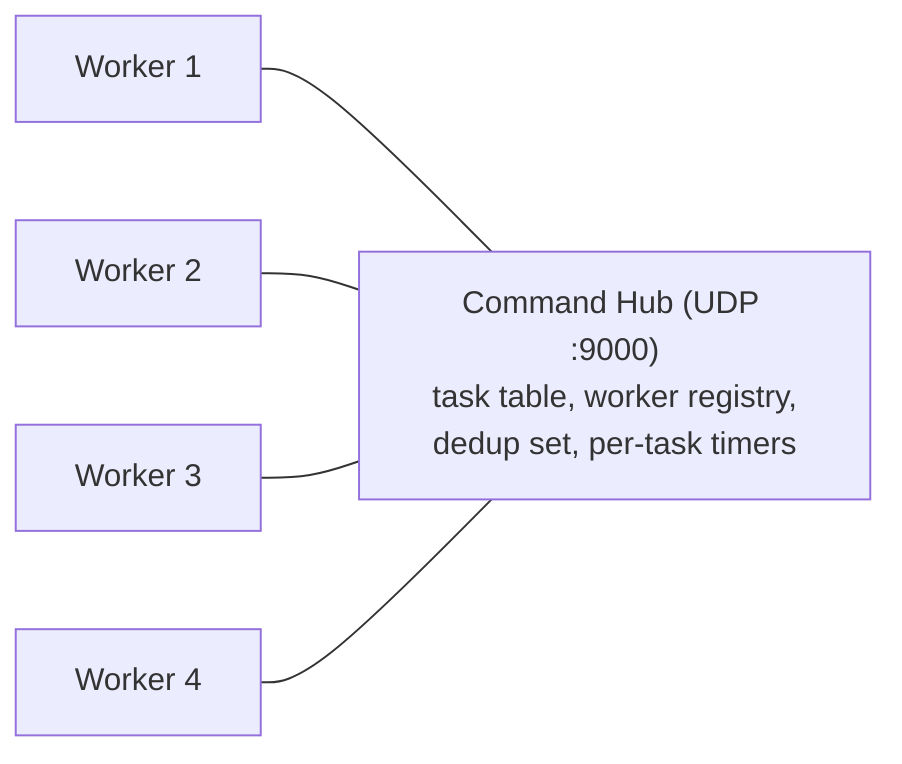
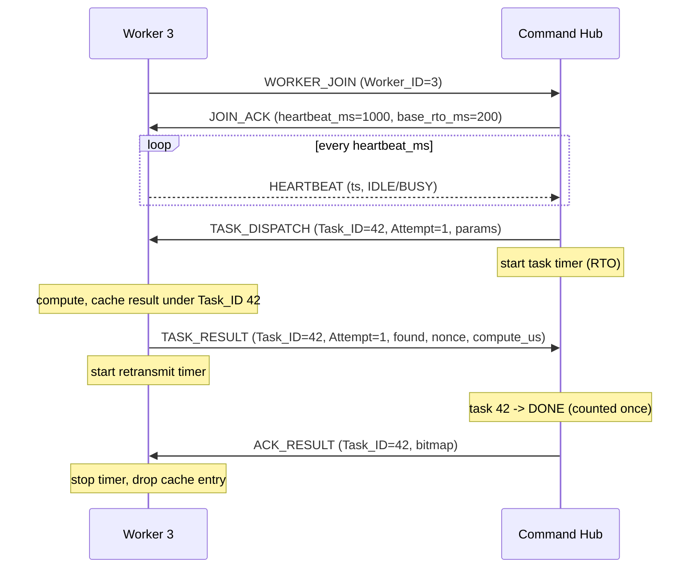
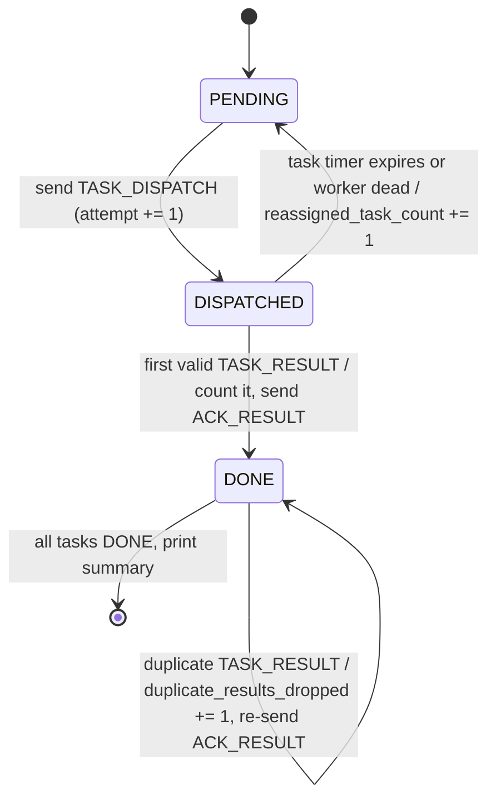
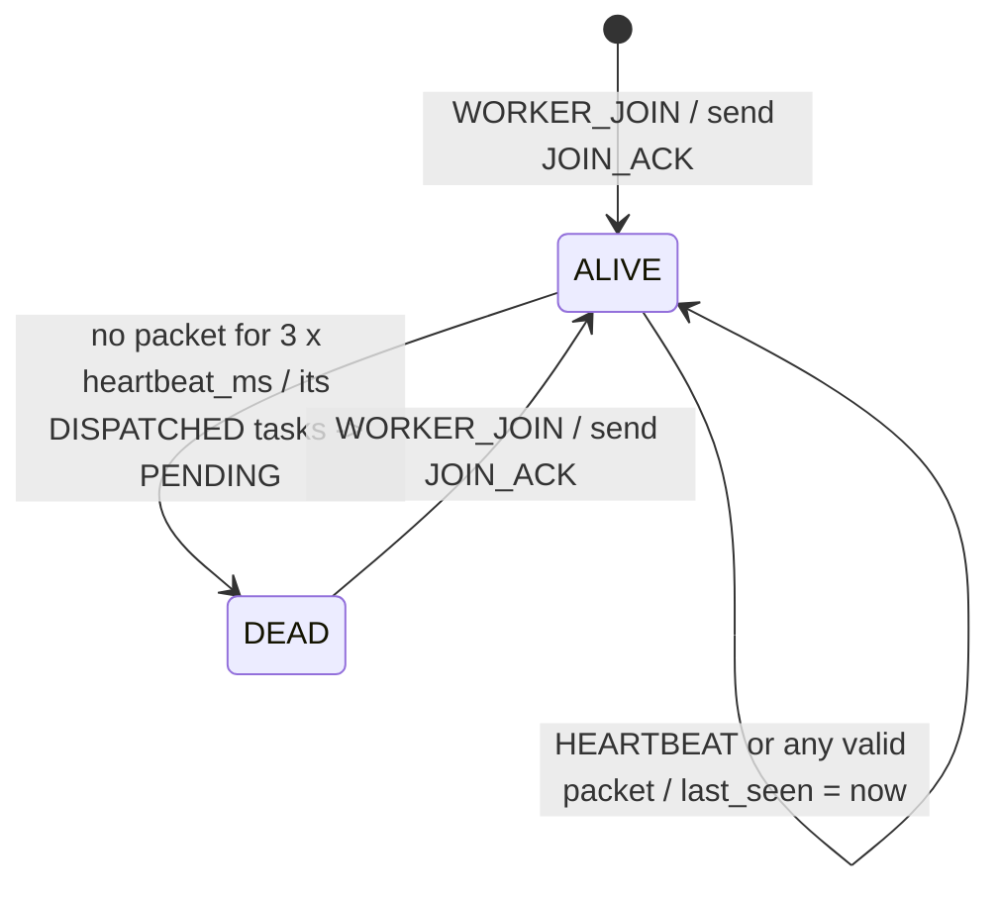
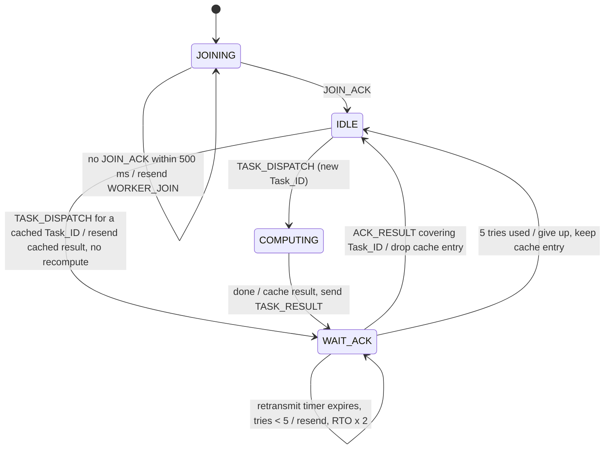

# RJDAP: Reliable Job Dispatch & Aggregation Protocol, Version 1

```
CSE361 Computer Networks, Fall 2026                     Team: ________
Mini-RFC (Phase 1 draft: sections 1-3)                  Editor: R1 (Protocol Architect)
Status: DRAFT                                           Wire version: 1  (tag protocol-v1)
```

> "RJDAP" is the working name. If the team picks a different unique name, change
> `PROTOCOL_NAME` in `src/protocol.py` and the title of this document. Nothing else depends on it.

---

## 1. Introduction

### 1.1 Purpose

RJDAP is an application-layer protocol over UDP. One **Command Hub** (server) hands out a queue of independent compute tasks to a pool of **workers** and collects the results. UDP may lose, delay, duplicate or reorder datagrams, and workers may crash. Even so, RJDAP guarantees that:

1. every task in the queue is eventually completed while at least one worker is alive, and
2. **every result is counted exactly once** by the Command Hub.

### 1.2 How exactly-once is achieved

UDP gives no delivery guarantee, so RJDAP builds exactly-once processing from two parts:

- **At-least-once delivery.** A sender keeps retransmitting a message until it is acknowledged, with bounded retries and backoff.
- **Idempotent receiving.** The Command Hub records every `Task_ID` that is DONE. A later result for a DONE task is not counted again, but it **is acknowledged again** so the sender stops retransmitting.

### 1.3 Scope

- **In scope:** worker registration, liveness (heartbeats), task dispatch, result return, acknowledgement, timeout-based reassignment, duplicate suppression, payload integrity, and fragmentation of payloads larger than 512 bytes (detailed in Phase 2).
- **Out of scope:** encryption, authentication, congestion control across the Internet, and a multi-server Command Hub.

### 1.4 Requirements language

The key words **MUST**, **MUST NOT**, **SHOULD** and **MAY** are to be read as described in RFC 2119.

### 1.5 Terminology

| Term | Meaning |
|---|---|
| Command Hub (S) | The single server that owns the task queue |
| Worker (W) | A client that executes tasks |
| Task | One stateless unit of work, identified by `Task_ID` |
| Attempt | One transmission of a task to a worker; counted by `Attempt_Num` (1, 2, 3...) |
| DONE | A task whose first valid result has been accepted by the Command Hub |
| RTT / RTO | Round-trip time / retransmission timeout |

---

## 2. Protocol Architecture

### 2.1 Entities and transport



- Transport: **UDP only**. The Command Hub listens on UDP port **9000** (configurable in `src/config.py`); each worker uses an ephemeral port.
- One RJDAP message is carried in exactly one UDP datagram: a 14-byte header followed by 0 to 512 bytes of payload. The maximum datagram is therefore 526 bytes, well under any common MTU, so IP fragmentation never happens.
- All multi-byte integers are **big-endian** (network byte order).
- Every node MUST use a non-blocking or timed receive (for example `socket.settimeout`) so it can service its timers.

### 2.2 Message types

| Code | Name | Direction | Purpose |
|---|---|---|---|
| 1 | `WORKER_JOIN` | W to S | Register (or re-register) a worker |
| 2 | `JOIN_ACK` | S to W | Confirm registration; tells the worker its timer settings |
| 3 | `HEARTBEAT` | W to S | "I am alive" plus idle/busy state |
| 4 | `TASK_DISPATCH` | S to W | Assign one task (one attempt) |
| 5 | `TASK_RESULT` | W to S | Return the outcome of a task |
| 6 | `ACK_RESULT` | S to W | Confirm a result (plus up to 32 earlier ones) |

`JOIN_ACK` is not in the brief's list. It was added because a worker must know that its join arrived before it can expect work. The brief allows "an ACK type or a flag"; a separate type keeps every handler simple.

### 2.3 Normal message flow



### 2.4 Command Hub: task state machine



Rules:
- A result is accepted for a task in DISPATCHED **or** PENDING state, from **any** worker and **any** attempt. The first valid result wins. This covers a late result from a worker whose task was already reassigned.
- A result for a DONE task MUST NOT be counted and MUST be acknowledged.

### 2.5 Command Hub: worker liveness state machine



A repeated `WORKER_JOIN` from an ALIVE worker is answered with `JOIN_ACK` again (the first `JOIN_ACK` may have been lost).

### 2.6 Worker state machine



Heartbeats are sent every `heartbeat_ms` in every state except JOINING. In Phase 1 a worker handles one task at a time.

### 2.7 Original mechanisms

RJDAP has two mechanisms that the team designed itself. Both are fully specified in sections 4 and 5 (Phase 2); their wire fields are already part of version 1.

**M1: Compute-compensated, attempt-matched adaptive timeout.**
Each `TASK_RESULT` carries `compute_us`, the time the worker spent computing, and echoes the `Attempt_Num` it answers. For every result the Command Hub takes an RTT sample:

```
sample = t_recv(result, attempt a) - t_send(dispatch, attempt a) - compute_us
```

It keeps per-worker `SRTT`/`RTTVAR` (Jacobson/Karels) and sets the task timeout to `RTO + 1.5 x expected_compute_time`.
*How it differs from TCP:* TCP cannot tell which transmission an ACK answers, so Karn's algorithm throws away samples from retransmitted segments. RJDAP's echoed `Attempt_Num` identifies the exact transmission, so every result gives a valid sample. Subtracting `compute_us` separates network delay from worker processing time; TCP never has to deal with processing time.

**M2: Cumulative ACK bitmap over independent tasks.**
`ACK_RESULT` acknowledges the `Task_ID` in its header. Its 32-bit payload bitmap also confirms which of the 32 preceding Task_IDs are DONE (bit *i* set means `Task_ID - (i + 1)` is DONE). If the ACK for one result was lost, any later ACK that covers it stops the worker's retransmission without an extra round trip.
*How it differs from TCP SACK:* SACK reports byte ranges of one ordered stream to one peer. RJDAP's bitmap reports completion of unordered, independent tasks that may have been computed by different workers.

---

## 3. Message Formats

### 3.1 Common header (14 bytes)

Every message starts with this header. Python `struct` format: **`'!BBHIBBHH'`**.

```
 0                   1                   2                   3
 0 1 2 3 4 5 6 7 8 9 0 1 2 3 4 5 6 7 8 9 0 1 2 3 4 5 6 7 8 9 0 1
+-------+-------+---------------+-------------------------------+
|Version|MsgType|     Flags     |           Worker_ID           |
+-------+-------+---------------+-------------------------------+
|                            Task_ID                            |
+---------------+-------+-------+-------------------------------+
|  Attempt_Num  |FragIdx|FragCnt|          Payload_Len          |
+---------------+-------+-------+-------------------------------+
|       Payload_Checksum        |   Payload (0-512 bytes) ...   |
+-------------------------------+-------------------------------+
```

| Offset | Bits | Field | Values / meaning |
|---|---|---|---|
| 0 | 4 (high) | Version | `1`. A receiver MUST drop any other value |
| 0 | 4 (low) | MsgType | 1-6 (section 2.2). 0 and 7-15 MUST be dropped |
| 1 | 8 | Flags | bit 0 `FRAG`, bit 1 `RETX`, bit 2 `LAST`; bits 3-7 MUST be sent as 0 and MUST be ignored on receipt |
| 2 | 16 | Worker_ID | 1-65535 identifies the worker (0 = not applicable) |
| 4 | 32 | Task_ID | Task the message refers to (0 when not about a task) |
| 8 | 8 | Attempt_Num | Which dispatch of this task (1-255); 0 when not about a task. A result echoes the attempt it answers |
| 9 | 4 (high) | FragIdx | Index of this fragment, 0-14 |
| 9 | 4 (low) | FragCnt | Total fragments, 1-15 (1 = not fragmented). FragIdx < FragCnt |
| 10 | 16 | Payload_Len | Payload bytes after the header, 0-512. MUST equal datagram length - 14 |
| 12 | 16 | Payload_Checksum | CRC-16/CCITT-FALSE (section 3.3) |

**Why these sizes**

| Field | Size | Reason |
|---|---|---|
| Version + MsgType | 4 + 4 bits | 16 versions and 16 types are plenty; packing both in one byte saves a byte in every packet |
| Flags | 8 bits | 3 used, 5 spare for later features without a version bump |
| Worker_ID | 16 bits | 8 bits (255 workers) would be enough for the tests; 16 bits keeps the header 4-byte aligned and allows large pools |
| Task_ID | 32 bits | 1,000 tasks need only 10 bits, but 32 bits never wraps within a run, allows several jobs, and starts at a 4-byte-aligned offset |
| Attempt_Num | 8 bits | Retries are capped at a handful; 255 attempts is far more than ever needed |
| FragIdx / FragCnt | 4 + 4 bits | Up to 15 x 512 B = 7,680 B per message, more than any RJDAP message needs |
| Payload_Len | 16 bits | Needs at least 10 bits for 512; 16 bits keeps byte alignment and lets the receiver detect truncation or padding |
| Payload_Checksum | 16 bits | CRC-16 detects every 1-, 2- and odd-bit error and every burst up to 16 bits in a 526-byte datagram, at 2 bytes of cost |

### 3.2 Flags

| Bit | Name | Meaning |
|---|---|---|
| 0x01 | `FRAG` | This datagram carries one fragment of a larger payload (Phase 2) |
| 0x02 | `RETX` | This datagram is a retransmission. Informational only (eases pcap analysis); receivers MUST NOT change behaviour based on it |
| 0x04 | `LAST` | Last fragment of a fragmented payload (Phase 2) |

### 3.3 Checksum

`Payload_Checksum` is CRC-16/CCITT-FALSE (polynomial `0x1021`, initial value `0xFFFF`, no reflection, no final XOR; check value of `"123456789"` is `0x29B1`). It is computed over:

```
header bytes 0-11  ||  0x00 0x00 (checksum field set to zero)  ||  payload
```

Despite its name (kept from the brief), the checksum also covers the header. A corrupted `Task_ID` or `MsgType` would be worse than a corrupted payload, because it could mark the wrong task DONE. A receiver that finds a mismatch MUST silently drop the datagram; timers recover the loss.

### 3.4 Payloads

| MsgType | Payload layout (`struct`) | Size | Fields |
|---|---|---|---|
| `WORKER_JOIN` | (empty) | 0 | Identity is in the header (`Worker_ID`, `Version`) |
| `JOIN_ACK` | `!HH` | 4 | `heartbeat_ms` (u16): heartbeat interval the worker MUST use; `base_rto_ms` (u16): initial result-retransmit timeout |
| `HEARTBEAT` | `!QB` | 9 | `sent_ts_us` (u64): worker clock in microseconds; `state` (u8): 0 IDLE, 1 BUSY |
| `TASK_DISPATCH` | `!16sQIB` + data | 29 + n | `job_key` (16 B); `start_nonce` (u64); `count` (u32): nonces to try; `difficulty_bits` (u8): required leading zero bits; `data`: optional extra task data (0 in Phase 1; fragmented in Phase 2) |
| `TASK_RESULT` | `!BQI` | 13 | `found` (u8, 0/1); `nonce` (u64): the nonce found (0 if none); `compute_us` (u32): time spent computing, used by mechanism M1 |
| `ACK_RESULT` | `!I` | 4 | `bitmap` (u32): bit *i* set means `Task_ID - (i + 1)` is also DONE (mechanism M2) |

A receiver MUST drop a datagram whose payload size does not match its MsgType (exact size, or at least 29 bytes for `TASK_DISPATCH`).

**The compute task.** The worker searches nonces `n` in `[start_nonce, start_nonce + count)` for the first one where `SHA-256(job_key || n as 8-byte big-endian)` starts with `difficulty_bits` zero bits. Tasks are stateless, so any worker can run any attempt.

### 3.5 Sample packets

All samples below are produced by `src/protocol.py` (Worker 3, Task 42).

**`TASK_DISPATCH`** (43 bytes):

```
14 00 00 03 00 00 00 2a 01 01 00 1d 9b bd
00 11 22 33 44 55 66 77 88 99 aa bb cc dd ee ff
00 00 00 00 00 20 0b 20  00 00 c3 50  10
```

| Bytes | Field | Value |
|---|---|---|
| `14` | Version / MsgType | 1 / 4 (`TASK_DISPATCH`) |
| `00` | Flags | none |
| `00 03` | Worker_ID | 3 |
| `00 00 00 2a` | Task_ID | 42 |
| `01` | Attempt_Num | 1 |
| `01` | FragIdx / FragCnt | 0 / 1 (not fragmented) |
| `00 1d` | Payload_Len | 29 |
| `9b bd` | Payload_Checksum | 0x9BBD |
| `00 11 ... ff` | job_key | 16 bytes |
| `00 00 00 00 00 20 0b 20` | start_nonce | 2,100,000 |
| `00 00 c3 50` | count | 50,000 |
| `10` | difficulty_bits | 16 |

**All message types:**

| Message | Len | Hex |
|---|---|---|
| `WORKER_JOIN` | 14 | `11 00 00 03 00 00 00 00 00 01 00 00 c6 57` |
| `JOIN_ACK` (1000 ms, 200 ms) | 18 | `12 00 00 03 00 00 00 00 00 01 00 04 44 df 03 e8 00 c8` |
| `HEARTBEAT` (ts 1,000,000 us, BUSY) | 23 | `13 00 00 03 00 00 00 00 00 01 00 09 de 9a 00 00 00 00 00 0f 42 40 01` |
| `TASK_RESULT` (found, nonce 2,131,337, 12.5 ms) | 27 | `15 00 00 03 00 00 00 2a 01 01 00 0d 88 b9 01 00 00 00 00 00 20 85 89 00 00 30 d4` |
| `ACK_RESULT` (42, also 41 and 39) | 18 | `16 00 00 03 00 00 00 2a 01 01 00 04 e9 d7 00 00 00 05` |

---

## 4. Protocol Procedures
*Phase 2: join/heartbeat/dispatch/result/ACK procedures, timer values, reassignment, fragmentation and reassembly rules.*

## 5. Reliability and Performance
*Phase 2: timeout formulas (M1), retry cap and backoff, duplicate-suppression state machine, ACK bitmap processing (M2), loss/reorder/duplication analysis.*

## 6. Experiment Plan
*Phase 2: the 4 scenarios, netem commands, seeds, 5 runs per measurement, metrics.*

## 7. Example Walkthrough
*Phase 2: annotated pcap excerpt of a retransmission and recovery (from R4).*

## 8. Limitations and Differences from Known Protocols
*Phase 3.*

## 9. References
*Phase 3.* RFC 2119 (requirement keywords); RFC 6298 (computing TCP's retransmission timer); RFC 2018 (TCP selective acknowledgment).

> Confirm that headings 4-9 match the 9 headings required by the brief, and rename them if needed.

